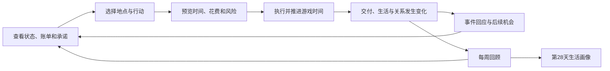

# 程序员生活模拟：实现方案 v0.1

设计日期：2026-11-07（Asia/Singapore）

状态：整体首版设计；首日原型已实现，实际范围与运行方式见 [README](../README.md)。数值与体验时长仍需试玩校准。

## 1. 产品定位与默认设定

**用一座能生活的小城市，模拟程序员在“今天把事情做完”和“以后还能好好生活”之间的选择。**

工作名为「程序员生活 / Programmer Life」。首版面向中文玩家，设定在虚构的「栈城」：玩家刚入职一家小型科技公司，有一间合租房、一台普通电脑、一笔积蓄，以及一个还没做完的个人项目。

一局覆盖 28 个游戏日。玩家可以争取转正、积累工程能力，也可以保持稳定生活、做出个人项目。结算呈现这一个月的生活画像，不用财富总分决定唯一赢家。

默认选择：浏览器优先、单人、桌面与手机可玩、无需登录、行动推进时间、没有离线惩罚。当前已进入首日原型实施阶段，完整 28 天为后续目标。

## 2. 如何借鉴 Lagos Life

参考范围为 Lagos Life 官方指南，未进行登录后的完整试玩。当前可确认：角色创建包含个性和目标；生活需求随时间变化；工作按班次获得收入；玩家通过城市地图选择地点与出行方式。[官方概览](https://lagoslife.app/wiki)、[角色创建](https://lagoslife.app/wiki/guide/life-creating-your-sim)、[需求系统](https://lagoslife.app/wiki/guide/life-needs-moods-and-skills)、[职业系统](https://lagoslife.app/wiki/guide/life-jobs-and-careers)、[地图系统](https://lagoslife.app/wiki/guide/world-the-map)。

据此提炼的设计判断是：**把需求、收入、住房与地点连接起来，让玩家为一种生活方式安排时间。** 以下程序员机制均为本项目的设计提案。

| 参考结构 | 本项目的转化 | 首版取舍 |
| --- | --- | --- |
| 角色、个性与人生目标 | 两种起点、两项性格、一个本月愿望 | 起点由玩家选择，可重复开局 |
| 生活需求与心情 | 精力、饱腹、心情、社交，加上长期压力 | 洗漱等并入日常整理，减少重复维护 |
| 工作、技能与收入 | 实际项目交付、工程能力、职业信用 | 一条初级工程师路线 |
| 城市地点与出行 | 家、公司、咖啡馆、便利店、公园、创客空间 | 六个地点，通勤消耗时间和现金 |
| 住房改善 | 便宜但远的合租房、贵但近的单间 | 两档住房，换房有明确收益与成本 |
| 人际互动 | 四名有立场、会记住选择的 NPC | 单机关系事件 |

保留城市与日常生活的可见性；多人社交、实时世界和复杂城市经营留到后续。参考产品的具体数值、资产、UI 和文案不作为复制目标。

## 3. 核心循环与游戏节奏



- **一次行动**：吃饭、通勤、工作、测试、学习、聊天、运动或睡眠。确认前展示已知成本与收益，风险用等级和原因解释。
- **一天**：约 6–10 次选择；常规吃饭、整理和通勤可存为一键日程模板，模板逐项执行，重要事件前停止。
- **一周**：交付、发薪、房租与周末构成不同节奏。每天至多一个主要随机事件，固定剧情单独计数，避免弹窗轰炸。
- **一局**：第 5 天完成第一次交付；第 14 天中期反馈；第 19 天完成第二次交付；第 4 周处理维护、兑现人际承诺和收尾个人项目；第 28 天结束时结算。

阅读选项时世界暂停。行动动画控制在约 0.5–2 秒，并可跳过；动画速度不改变游戏结果。目标是前 10 分钟完成第 5 天的首次交付，整局约 45–60 分钟，实际以试玩为准。第一周即提供“重复昨日基础日程”，遇到主要事件时停止。

### 首局前 10 分钟

| 阶段 | 玩家经历 | 验证什么 |
| --- | --- | --- |
| 第 1 天 | 选择起点，进入住处，看到床、电脑、冰箱与本周账单 | 这是能生活的场景，知道自己为何行动 |
| 第 1–2 天 | 到公司领取小功能任务，安排实现、测试与下班活动 | 一次行动有多方面影响 |
| 第 3 天 | 产品经理提出临时变更：全接、缩范围、申请延后 | 沟通可以改变任务本身 |
| 第 4 天 | 同事依据此前互动提供帮助，或要求先帮忙 | 关系有记忆与实际作用 |
| 第 5 天 | 交付，看到兑现承诺、质量与个人状态的共同结果 | 体验一次完整的因果闭环 |

新手引导只解释当前需要的操作。第一份任务不设计必败陷阱；即使失败，也能继续修复并进入下一周。

## 4. 角色、生活与经济

### 状态分层

| 维度 | 用途 | 变化方式 |
| --- | --- | --- |
| 精力 0–100 | 今天还能做多少事 | 工作消耗，睡眠恢复 |
| 饱腹 0–100 | 短期日常需求 | 随行动时间下降，吃饭恢复 |
| 心情 0–100 | 影响学习和专注状态 | 娱乐、成就、挫折、生活事件 |
| 社交 0–100 | 表达与人联系的需求 | 独处降低，互动恢复 |
| 压力 0–100 | 累积数日的负担 | 连续赶工与失约增加，持续休息降低 |
| 工程能力 | 决定实现、排错和审查效率 | 实践与学习积累；首版用单一技能 |
| 职业信用 | 决定授权、支持和转正评价 | 兑现承诺、主动预警、交付质量 |
| 现金、欠款 | 形成生活选择 | 工资、房租、饮食、交通和设备 |

心情表达当下感受，压力表达长期负担，两者不互为简单反数。轻度低需求降低效率并给出可执行提示；精力归零触发回家恢复。压力持续高位触发恢复事件与机会成本，首版不做健康诊断或死亡机制。

两种起点：应届新人（积蓄较少、学习基础较好）和转行新人（积蓄较多、工程经验较少）。两种起点均从同一岗位开始，优势与短板在卡片中写清。可选性格如专注、外向、夜猫子、求稳，每项同时带来便利和限制。

### 初始经济参数

以下是游戏平衡起点，不映射真实城市物价或劳动制度。

| 项目 | 暂定值或规则 |
| --- | --- |
| 初始积蓄 | 应届 ¥3,000；转行 ¥5,000 |
| 工资 | 满勤每周 ¥2,500，第 5/12/19/26 天 18:00 发放 |
| 考勤 | 工作日每天最多计 360 分钟有效工作；周薪按计入分钟 / 1,800 折算，上限 ¥2,500。其余四个工作日均满勤时，可补足一天已申请的请假 |
| 有效工作 | 公司内实现、测试、评审与工作沟通；重复点击不额外计薪 |
| 便宜合租 | ¥700/周；单程通勤 45 分钟、¥6 |
| 公司附近单间 | ¥1,200/周；单程通勤 15 分钟、¥3 |
| 房租 | 按完整游戏周后付，第 8/15/22/29 天 00:00 各收一次，分别覆盖第 1–7/8–14/15–21/22–28 天；最后一期先于终局结算 |
| 日常饮食 | 约 ¥35–60/天，自炊便宜但耗时 |
| 换房 | 新旧租金从下个租金周期切换；搬家费 ¥300，避免反复切换套利 |

现金不足时先支付可用现金，差额生成独立欠租记录与三个游戏日的宽限期，现金不直接变成可无限消费的负数。每局可申请一次 ¥1,000 应急援助；若正在住单间，同时免费搬回合租房，下个周期使用低租金。援助进入欠款，之后每次工资到账时用工资的 20% 自动还款，直至还清；该笔扣款发生在工资入账后、房租扣款前。逾期进入必须处理的事件，只允许足额还款、符合条件的援助或结束本局，不能关闭事件继续拖欠。

账单面板持续显示下次工资、应付房租、预计余额。首版的财务目标是预算取舍：正常工作时两种住房均可持续，单间每周少存 ¥500，设备升级与住房竞争可支配资金。三项设备初始价格设为 ¥1,000 / ¥1,500 / ¥2,500，分别改善久坐压力、评审效率与构建耗时，具体收益等待原型校准。

用于校准的周预算：满勤合租扣房租、饮食和通勤后约余 ¥1,320–1,495；满勤单间约余 ¥850–1,025；只工作三个完整工作日的合租玩家约余 ¥344–519，获得更多个人项目时间。这里未计设备和事件开支，不把“经济压力”误当成必须频繁破产。

## 5. 程序员特有的玩法

### 项目：进度、质量与技术债

工作项目同时记录范围、进度、测试覆盖、技术债、截止时间和承诺。进度到 100% 后仍需选择交付；范围协商会改变需求量和验收条件。

| 行动 | 眼前收益 | 后续影响 |
| --- | --- | --- |
| 专注实现 | 稳定推进需求 | 消耗精力，能力影响效率 |
| 快速赶工 | 单位时间进度更高 | 技术债与压力增加 |
| 测试与评审 | 减少缺陷风险 | 占用实现时间，可能发现返工 |
| 重构 | 降低技术债 | 短期进度较少，后续维护更省时 |
| 沟通范围 | 可能降低交付范围或延后截止 | 改变承诺与评价依据 |
| 帮助同事 | 增加信任、获得工程经验 | 当天工作时间减少，未来可获得帮助 |
| AI 辅助实现 | 提高初次实现速度 | 工程能力和验证投入决定隐藏缺陷风险 |

AI 是工具选项，不调用真实模型。玩家可在快速生成后补验证，也可纯手工完成；手工方案同样有缺陷风险。

初步规则：工作产出由「基础效率 × 工程能力系数 × 精力系数 × 行动策略」决定。缺陷风险由技术债、测试投入、当时状态与任务复杂度共同决定。具体参数集中放在平衡配置中；风险在交付时抽样，不在每帧或每次打开面板时抽样。

技术债有两种可见后果：后续实现需要更多时间；交付后可能进入维护事件。先用标记和事件表现这些后果，首版不建立复杂代码依赖图。

### 让选择改变以后发生的事

首版手写 32 个事件定义，按前置条件选择分支，并非每局全部出现：8 个入职与交付节点、8 个工程事件、8 个关系事件、8 个生活事件。

示例事件链：

> 临时加需求 → 选择「先做完，测试以后补」 → 本周按时上线 → 留下 `skipped-review` 标记 → 下一周出现数据边界问题 → 同事是否愿意协助，取决于此前的互助与信任。

同一事件必须至少有两个有理由的选项。已知花费明确展示，未知结果说明风险原因；避免只有一个正确答案的道德测验。

四名 NPC：产品经理关心范围和承诺，资深同事关心质量与互助，室友关心作息和公共生活，开源朋友关心个人项目。每人保存信任值与少量事实标记，使用预写对话和分支，不引入生成式聊天。

一个可选个人项目由原型、可用 Demo、公开发布三个节点构成，需要开发、验证和反馈。首版不承诺稳定被动收入，也不扩展为完整创业经营系统。

### 结算与复玩

第 28 天先完成到期结算，再展示现金与欠款、两次交付、工程成长、职业反馈、生活状态、关系和个人项目成果。根据记录生成「顺利转正」「作品起步」「生活稳定」「调整节奏」等可并存标签。

交付失败进入返工，信用低会减少授权，持续透支会消耗恢复时间；这些都是可继续游玩的挫折。复玩来自起点、性格、事件种子、不同承诺和生活路线。回顾至少引用三次具体选择，让玩家知道这局为何如此。

## 6. 场景与交互设计

视觉方向：温暖的等距小城市、清楚的建筑轮廓、昼夜配色和少量人物动作。工作场景带显示器、白板与同事；住处展示床、书桌、冰箱、沙发和可升级设备。风格保持轻松，程序员梗放在事件与物件描述中。

**首版要有小人、有房间、有城市。** 按用户要求对照 Lagos Life 复刻全屏三维视觉，使用 Three.js 和原创低多边形模型，人物在实际执行行动后沿预设锚点移动。完整交互房间只有家和公司，其余四个地点使用城市建筑与活动卡；不要求自由行走、物理碰撞或寻路。

桌面布局草图：

```text
┌──────────────────────────────────────────────────────────┐
│ 第3天 18:00  ¥2,340   精力 / 饱腹 / 心情 / 社交   压力    │
├────────────┬───────────────────────────┬─────────────────┤
│ 今日承诺   │                           │ 地点与行动      │
│ 交付倒计时 │      城市 / 房间场景      │ 时长、花费      │
│ 工资房租   │      人物与可点击物件    │ 收益与风险      │
│ 个人项目   │                           │ 确认行动        │
├────────────┴───────────────────────────┴─────────────────┤
│ 最近变化与原因                         城市 / 项目 / 手机 │
└──────────────────────────────────────────────────────────┘
```

手机布局：顶部显示日期、现金和关键预警；场景占上半屏，点物件后底部弹出行动抽屉；底部导航切换城市、项目和手机。NPC 消息、账单、存档归入手机。

点击顺序统一为：选物件或地点 → 看行动预览 → 确认 → 显示结果。移动到远处先给通勤方式选择。主场景配有等价的地点/行动列表，支持键盘、触屏和减少动画设置；状态不只依赖颜色区分。

## 7. MVP 内容边界

| 必须完成 | 数量与标准 |
| --- | --- |
| 开局 | 2 种背景、4 种性格中选 2 项、1 个本月愿望 |
| 场景 | 6 地点，家和公司可进入，2 档住房 |
| 行动 | 约 20 个定义；常规日程可重复执行 |
| 工作 | 1 个岗位、2 个交付项目、一次中期反馈与期末评价 |
| 个人成长 | 1 项工程能力、1 个个人项目、3 项设备升级 |
| 关系与事件 | 4 名 NPC、32 个带条件分支的手写事件 |
| 完整一局 | 28 天、工资房租、失败补救、生活画像 |
| 存档 | 自动存档、上次有效备份、JSON 导入导出 |

首版之后再考虑：多职业与跳槽、远程工作、自由职业、创业、恋爱、更多城市、家具布置、更多镜头模式、云存档和多人世界。每一项都依赖首版已证明核心循环有趣。

## 8. 技术方案

### 最小技术栈

| 部分 | 选择 | 理由 |
| --- | --- | --- |
| 应用与界面 | React + TypeScript + Vite | 组织多面板、事件与状态，输出可部署的静态应用 |
| 场景 | Three.js + OrbitControls + CSS 浮层 | 全屏低多边形世界，实时阴影、旋转缩放与物件热点；SVG 作为无 WebGL 时的后备 |
| 状态 | React Context + reducer；独立纯函数引擎 | 保持业务规则可脱离 UI 运行 |
| 存档 | 小体积 JSON + localStorage | 首版只需一个本地人生，无服务端依赖 |
| 验证 | 引擎单测、策略模拟、少量浏览器端到端检查 | 优先防止重复结算和存档破坏 |

React 的组件与状态机制、Vite 的静态构建能力见 [React 文档](https://react.dev/learn) 与 [Vite 文档](https://vite.dev/guide/)。localStorage 可跨浏览器会话保存同源数据，但属于同步存储；因此只保存小型状态与有上限的记录，未来数据增大再迁移 IndexedDB。[Web Storage 文档](https://developer.mozilla.org/en-US/docs/Web/API/Web_Storage_API)

实施时选兼容的稳定依赖并提交锁文件。按用户视觉复刻要求，首版已引入 Three.js；不引入后端、账号、WebSocket 或付费模型服务。

### 计划目录结构

以下为实施阶段的目录结构；首日原型已按此模块划分实现，并新增 src/world/ 管理三维模型。视觉复刻细节见 [复刻记录](visual-parity.md)。

```text
programmer-life/
├── README.md
├── docs/implementation-plan.md
├── public/assets/          # 原创人物与场景资源
└── src/
    ├── domain/             # 状态、命令、时间、项目、经济、事件、结局
    ├── content/            # 地点、行动、NPC、事件、平衡参数
    ├── application/        # 命令提交、读写顺序、并发保护
    ├── persistence/        # 存档校验、迁移、导入导出
    ├── ui/                 # 城市、房间、HUD、行动卡、手机、回顾
    └── styles/             # 主题、响应式布局、动画
```

规则与数值放在 `domain` / `content`，组件只展示结果并提交命令。内容采用带类型的 TypeScript 数据与条件/效果描述，避免每加一个事件就改界面组件。

### 核心数据模型

```ts
type GameState = {
  schemaVersion: number;
  rulesVersion: string;
  runId: string;
  revision: number;
  rngState: number;
  minute: number;                 // 从第1天00:00起的整数分钟
  phase: 'playing' | 'event' | 'ended';
  player: PlayerState;            // 需求、压力、能力、性格、现金(整数分)
  locationId: string;
  housing: HousingState;
  career: CareerState;            // 考勤、工资、信用、评价
  projects: ProjectState[];
  relationships: Record<string, RelationshipState>;
  obligations: ObligationState[]; // 房租与援助欠款、周期、到期日
  flags: Record<string, boolean | number | string>;
  pendingEventIds: string[];
  processedScheduleIds: string[];
  processedCommandIds: string[];
  journal: JournalEntry[];
  ending?: EndingSummary;
};

type Command = {
  id: string;
  expectedRevision: number;
  kind: 'act' | 'choose-event' | 'deliver' | 'settle-boundary';
  targetId: string;
  params?: Record<string, string | number>;
};

type TransitionResult = {
  nextState: GameState;
  changes: ChangeRecord[];        // 用于解释本次钱、状态与项目的变化
  presentation: PresentationCue[]; // 仅供动画使用，不影响结算
};
```

`transition(state, command, content)` 返回完整新状态。时间与随机结果都不从组件、动画或现实系统时钟读取；存档保留 RNG 状态，读档不会重新抽取当前事件。

## 9. 时间、结算与存档的一致性

这一部分应先实现，后续玩法都依赖它。

1. **命令只提交一次**：校验状态版本、地点、时段、费用和前置条件；重复命令返回已有结果，旧版本命令被拒绝。按钮禁用只是交互保护，规则层仍需去重。
2. **模拟时间与动画分开**：验证后先计算整个事务，提交内存状态并执行命令去重，再保存与播放动画。每次保存写完整快照；失败重试只保存当前最新 revision，不重跑命令。刷新恢复最近成功保存的结果，不依赖定时器补发奖励。
3. **跨日按边界分段**：推进到每个日界、发薪、房租和截止节点，应用相应规则，再继续行动。睡眠可跨日，不能跳过账单。
4. **同刻顺序固定**：恰好在边界完成的行动效果 → 工资及援助还款 → 房租/到期欠款 → 项目截止评价 → 每日状态检查 → 终局 → 普通事件。每个周期使用唯一 ID，如 `rent:week-2`，并保留处理记录。
5. **截止不可越过**：工作、学习、睡眠等可分割行动缩短至项目截止或赛季终点，需求变化、收益和按时长计费都按实际分钟结算。通勤、购物等不可分割行动若会越过这类边界，则不接受命令，提供先推进到边界的选项；未完成的通勤不改变位置。截止前明确提醒交付，并提供“做至截止并交付”，先提交已有成果再执行截止评价。普通实现命令不自动交付，进度已满但未提交仍视为未交付。
6. **事件不打断半个行动**：行动完成后统一触发；有待选事件时禁止提交下一行动。睡眠期间产生的普通消息在醒来后处理，固定账单照常结算。
7. **赛季终点唯一**：第 29 天 00:00 即第 28 天结束。先完成到期处理，再生成回顾，禁止继续获得收益。多日行动在此截断。
8. **保存有反馈**：事务结束写入一个完整存档对象，并保留上次有效备份；写失败时内存状态仍为权威，明确显示未保存，并提供重试或导出。写入串行处理，旧快照不得覆盖新 revision。

存档导入校验版本、结构、ID、数值范围与有限数值，拒绝未知未来版本；旧版本通过迁移函数处理。当前记录设置体积上限，历史压缩成每日/每周摘要。多标签页使用单写者锁，并通过 revision 与 `storage` 事件检查外部变化；无法取得锁的页面只读，避免两个页面覆盖人生。

首版单机可自行修改存档，因此不提供公平竞技排行榜。清除浏览器数据会影响本地进度，设置中提供容易找到的导出入口。

## 10. 开发顺序与验收

按可玩结果推进，每个阶段达到退出条件再扩内容。以下为工作拆分，不承诺未经实现验证的工期。

| 阶段 | 交付物 | 退出条件 |
| --- | --- | --- |
| M0：规则骨架 | 状态、命令、时钟、种子随机、经济与存档 | 相同起点和命令可复现；跨日不重复扣款 |
| M1：第一天 | 简单家/公司场景、人物、通勤、工作、吃饭、睡觉、一次事件 | 能从开局走到次日，刷新后完整继续 |
| M2：第一周 | 首次交付、范围沟通、NPC 记忆、发薪房租、基础日程复用 | 前 10 分钟完成第 5 天交付；第一周账单正确；失败后可继续 |
| M3：完整一局 | 28 天、第二次交付、个人项目、生活画像 | 三条不同策略均能完成且结果不同 |
| M4：完成体验 | 原创场景细化、日程模板编辑、手机适配、反馈与内容调校 | 目标设备可玩，无阻断问题，导出导入可用 |

### 关键验证

- **引擎**：确定性回放；所有状态有边界；需求不会因离线改变；连续点击不重复收益；跨多个日界正常处理。
- **结算**：工资、房租同刻顺序；周期只执行一次；项目截止与终局不能被长行动绕过；截断睡眠不获得完整恢复；不可分割行动不越界；请假额度与考勤不超计；第 4 期房租进入终局账本。
- **存档**：读档前后下一步结果一致；损坏档可恢复备份；旧档迁移；写入失败可导出；多标签页只能一处写入。
- **玩法**：用稳定工作、阶段冲刺、个人项目优先三种脚本走完整局，比较现金、质量、压力和关系；验证没有一条行动路线在所有维度都最优。
- **人工试玩**：首次游玩能说明“我为什么失败/成功”；至少五位试玩者中四位可在无口头指导下完成第一次交付；观察真实局长，再调整行动次数与事件密度。
- **界面**：桌面和约 390px 宽手机完成首日；按钮与文本可用；减少动画设置生效；关键预警有行动入口。

不为纯文案和低影响样式堆叠测试；自动验证集中在规则、财务、确定性与存档。

## 11. 主要风险与实施决策

| 风险 | 应对 |
| --- | --- |
| 日常需求变成重复劳动 | 少量需求、日程模板、每天一个主要决策、周末不同节奏 |
| 只有职场，没有生活 | 场景和事件同时覆盖居住、朋友、运动与个人项目；结局不唯绩效 |
| 玩法只是换皮加减数值 | 保留任务范围变化、技术债后果、NPC 记忆和承诺链 |
| 内容规模拖慢实现 | 六地点、两个可进入房间、一个职业、32 个条件事件封顶 |
| 画面完成但规则空洞 | M1 保留场景感，M2 先验证一周因果，再扩美术和内容 |
| 随机事故显得不公平 | 选择前显示风险原因；初局降低波动；事故提供修复路径 |
| 三维场景规模扩大 | 复用基础几何、限制模型与阴影开销，保留固定热点；生成式 AI 仍使用手写规则 |

下一步实施从 M0 + M1 开始：做出“一个角色、两个房间、一天生活”的可玩切片，并直接用第一周的真实取舍检验它。
